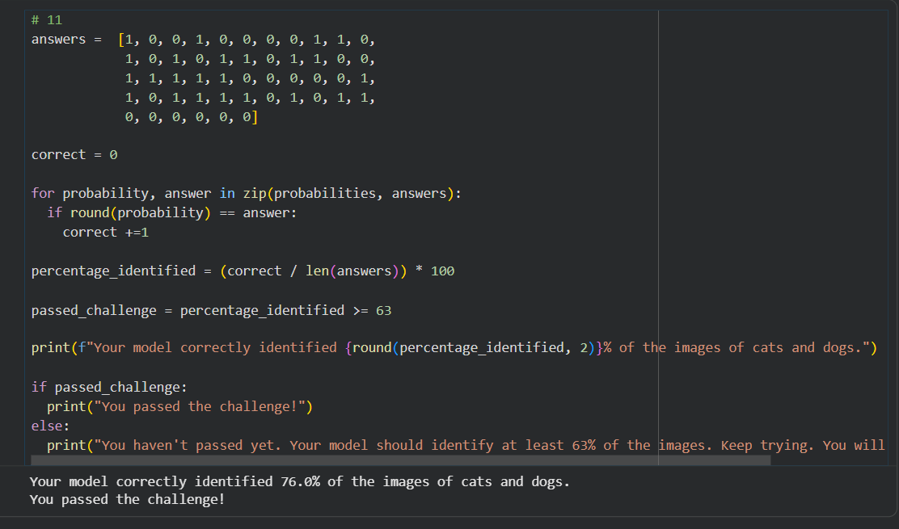

# Cat & Dog Image Classifier

## Project Overview
A deep learning project that classifies images into two categories: cats and dogs. The model learns visual patterns from labeled images to predict the category of an input image.

## Technologies Used
- Python
- TensorFlow
- Keras
- Convolutional Neural Networks (CNN)
- Image Preprocessing
- Model Evaluation

## Model Performance
The model achieved **76% test accuracy** on the evaluation dataset.

## Project Workflow
1. Load and prepare the image dataset.
2. Preprocess images for model training.
3. Build and train a CNN-based image classification model.
4. Evaluate model performance on unseen test images.

## Project Objective
The goal is to apply deep learning techniques to a computer vision classification task and evaluate how well the model distinguishes between cats and dogs.

## Future Improvements
- Improve classification accuracy through model tuning.
- Apply data augmentation to improve generalization.
- Test predictions on new images through a simple user interface.

---

**Project Category:** Machine Learning · Deep Learning · Computer Vision
